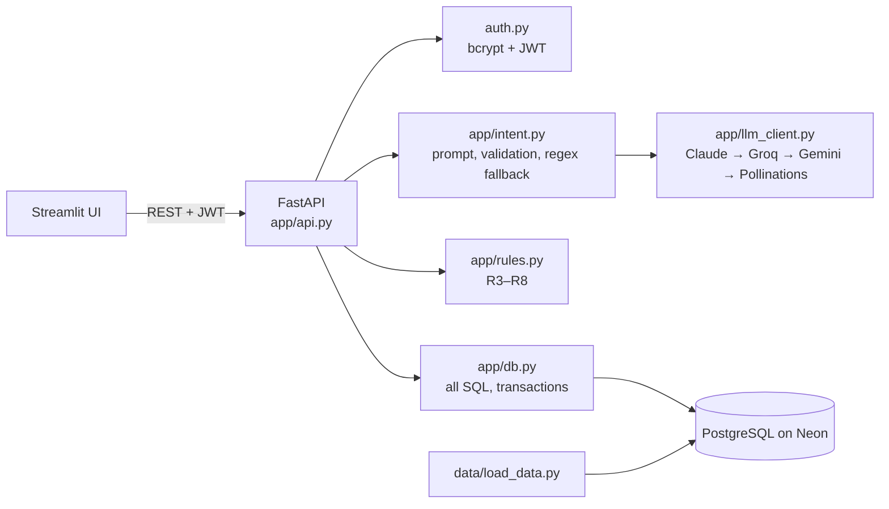

# Project Report: Autonomous Customer Support Agent

**Team Logic** · HCLTech AI Engineer Hackathon 2026 · Use case: Agentic AI, Option B (Autonomous Customer Support)

Kalabandi Pramith Joy · Ganivada Lalith · Sparsh Mishra · Chitteti Vagdevi · Banoth Arvind Nayak

---

## 1. Summary

We built an AI customer support agent that turns plain-language chat requests into safe, verified database updates. A customer can change a delivery address, cancel an order, postpone a delivery, or track an order by typing a message.

The agent understands the message with an LLM and checks the customer's identity and ownership of the order. It then validates the request against twelve business rules, shows the exact change for confirmation, and applies it in a single PostgreSQL transaction with a full audit trail.

The LLM never writes to the database. Every change is checked twice, confirmed by the customer, and applied exactly once.

| Outcome | Result |
| --- | --- |
| Supported requests | Change address, cancel order, postpone delivery, track order; refunds and complaints escalated |
| Business rules enforced | 12 (R1–R12) |
| Data | 200 real customers, 3,579 orders, 5,428 order items, 5,113 products (Kaggle) |
| Automated tests | 120 passing |
| LLM availability | 4 providers with automatic failover, plus an offline fallback |

---

## 2. Problem and objectives

Support teams receive a high volume of routine order requests. Automating them is risky. An AI that misreads a message, acts on the wrong order, or changes an order that has already shipped causes real harm to customers and the business.

**Objectives**

1. Understand free-text customer requests reliably.
2. Verify who the customer is and that the order belongs to them.
3. Enforce business rules: no cancelling shipped orders, no changes on failed payments, and no double booking.
4. Show the customer exactly what will change before anything is written.
5. Apply changes atomically, with isolation between concurrent requests.
6. Record every decision for audit.

---

## 3. Solution overview

The agent runs a fixed, explainable pipeline for every message:

```
Message → ① Verify identity → ② Understand intent → ③ Check ownership → ④ Check business rules
        → ⑤ Show preview and wait for Confirm → ⑥ Re-check and apply in one transaction → Audit
```



Design principles:

- **The LLM only reads.** It fills a strict, validated form (intent, order, value). All decisions and writes are made by deterministic code.
- **Confirm before change.** The preview is built from database values, not from LLM text.
- **Defence in depth.** The rules are checked in application code and again inside the transaction, and the database schema enforces its own constraints.
- **Always available.** If every LLM provider fails, a deterministic regex parser takes over.

---

## 4. Technology stack

| Layer | Technology | Reason for choice |
| --- | --- | --- |
| Language | Python 3 | One language across data, backend, AI and UI |
| Database | PostgreSQL (Neon serverless) | Row-level locks, ACID transactions, CHECK constraints, partial unique indexes, JSONB |
| Data access | SQLAlchemy 2.0 Core, psycopg 3 | Parameterised queries and connection pooling |
| Data processing | pandas | Cleaning and sampling a 256 MB transactions file |
| Backend | FastAPI, Uvicorn | Typed request validation and automatic OpenAPI docs |
| Validation | Pydantic v2, pydantic-settings | Strict schemas for requests and LLM output; settings from `.env` |
| Authentication | OAuth2 password flow, JWT (PyJWT), bcrypt | Stateless sessions; PINs stored only as hashes |
| LLM | Anthropic Claude (SDK), Groq, Google Gemini, Pollinations (OpenAI-compatible APIs via httpx) | Automatic failover across providers; no single point of failure |
| Agent framework | LangChain (`langchain_agent.py`) | Provider and prompt abstraction used by the earlier API |
| Frontend | Streamlit | Full chat UI in Python |
| Testing | pytest, FastAPI TestClient | Unit and end-to-end tests on a real PostgreSQL |
| Tooling | Git, GitHub, PowerShell, Mermaid | Collaboration, demo launcher, diagrams |

**Alternatives considered:**
- **SQLite:** rejected. It locks the whole file and has no `SELECT … FOR UPDATE`.
- **MongoDB:** rejected. It has no foreign keys between orders and items.
- **Google OAuth:** rejected. It proves ownership of a Google account, not of an order.
- **LangGraph:** planned, but replaced by a fixed pipeline that is simpler to verify and fully traceable.

---

## 5. System components

### 5.1 Database (`db/schema.sql`, `app/db.py`)

Six tables sit in the `app` schema. A `raw` schema mirrors the CSV shape.

| Table | Purpose | Key protections |
| --- | --- | --- |
| `customers` | Login identities | Unique email; PIN stored as a bcrypt hash |
| `products` | Catalog | Primary key |
| `orders` | The only table the agent changes | CHECK on status, payment and address; generated `order_ref`; `version` counter |
| `order_items` | Products per order | Composite key; quantity > 0 |
| `change_requests` | Pending previews | **Partial unique index**: one pending change per order; unique idempotency key; 5-minute expiry |
| `audit_log` | Every decision | **Append-only**: a trigger blocks UPDATE and DELETE |

All SQL lives in `app/db.py`. Every query is parameterised, and every order query filters by the authenticated customer's ID.

The function `apply_change_request` performs each change in one transaction:

1. Lock the preview and the order (`SELECT … FOR UPDATE`).
2. Reject the change if the preview is already applied or has expired.
3. Reject the change if the order `version` changed since the preview (optimistic locking).
4. Re-run the business rules on the locked row.
5. Update the one permitted column and increment `version`.
6. Mark the request applied, write the audit row, and commit. Any failure rolls back.

### 5.2 Data ingestion (`data/load_data.py`)

The source is the Kaggle "E-commerce App Transactional Dataset": 100,000 customers, 44,424 products and 852,584 transactions. The loader:

1. Validates every row and counts rejects.
2. Takes a reproducible 200-customer sample (seed 42).
3. Splits product lists into order items.
4. Derives order status (failed payments stay `placed`).
5. Shifts dates to the present.
6. Hashes the demo PINs.
7. Loads everything in one transaction.

It rejected 28 rows (22 malformed customer lines and 6 order items with an unknown product or bad price) and recorded them in `data/DATA_REPORT.md`. The raw data, about 290 MB, is git-ignored; the loader rebuilds the same database on any machine.

### 5.3 Language understanding (`app/intent.py`, `app/llm_client.py`)

- **Prompt.** A system prompt and few-shot examples, including a prompt-injection case, require JSON only. The customer's message is passed as data, not as instructions.
- **Validation.** The Pydantic model `ParsedIntent` rejects malformed output.
- **Post-checks** run in code, not by the LLM:
  - an order the customer doesn't own is dropped,
  - a missing field becomes a clarifying question,
  - confidence below 0.70 means the agent asks rather than acts (R11).
- **Failover.** Providers are tried in the order Claude, Groq, Gemini, then Pollinations. If all fail, a regex parser takes over. It tolerates typos ("cancle", "adress"), synonyms and bare order numbers.
- **Replies** are templates filled with database facts. Any LLM wording is fact-checked, so it can't introduce numbers or dates that aren't in the facts.

### 5.4 Business rules (`app/rules.py`, `docs/BUSINESS_RULES.md`)

| ID | Rule |
| --- | --- |
| R1 | Customer must be authenticated; identity only from the token |
| R2 | Order must belong to the customer |
| R3 | Cancel only while `placed` |
| R4 | Address change only while `placed` |
| R5 | Failed payment blocks address change and postpone (cancel allowed) |
| R6 | Address of at least 5 characters, in the order's country |
| R7 | No change when the new value equals the current one |
| R8 | Postpone only if not delivered or cancelled, after today, and within 7 days of the original date |
| R9 | One pending change per order; preview expires after 5 minutes |
| R10 | Rules and order version re-checked at confirmation |
| R11 | Low confidence or a missing field means a clarifying question |
| R12 | Refunds, returns and complaints are escalated to a human |

### 5.5 Backend API (`app/api.py`, `auth.py`)

| Endpoint | Purpose |
| --- | --- |
| `POST /login` | Email + PIN; returns a JWT |
| `POST /chat` | Parse, check ownership and rules, return a preview and a decision trace |
| `POST /confirm` | Confirm or decline a preview |
| `GET /orders`, `GET /orders/{id}` | The customer's own orders with items |
| `GET /products`, `POST /orders` | Catalog and order placement |
| `GET /audit`, `GET /me`, `GET /health` | History, profile, service status |

Security measures:
- bcrypt PIN hashing
- constant-time response for unknown emails
- lockout after 5 failed logins
- JWT with a fixed algorithm and required expiry

Every `/chat` response includes a **trace** of each pipeline step and rule result.

### 5.6 Frontend (`streamlit_app.py`)

- **Login gate.** Nothing is shown until authentication succeeds.
- **Order Support Desk.** Chat with a confirmation card (current value next to the proposed value, with Confirm and Decline buttons) and an expandable guardrail trace.
- **My Orders & Tracking.** Order details. Action buttons are enabled only when the rules allow them.
- **Store Catalog.** Place an order, then manage it through the agent.
- **Switch Customer.** Shows tenant isolation between demo users.

---

## 6. Safety and reliability

| Risk | Mitigation |
| --- | --- |
| LLM hallucination or prompt injection | LLM has no write access; output schema-validated; ownership and rules checked in code |
| Acting on another customer's order | Identity only from the JWT; every query filtered by customer ID; "not found" reveals nothing |
| Change applied twice (double click, retry) | Request status check, unique idempotency key, row lock |
| Two changes on one order (double booking) | Partial unique index on pending requests |
| Order changed between preview and confirm | Version check and rule re-check on the locked row |
| Partial writes | Single transaction; rollback on any error |
| SQL injection | Parameterised queries; updatable columns from a fixed whitelist |
| LLM outage or quota exhaustion | Four-provider failover, then the regex parser |
| Tampering with history | Append-only audit log enforced by a database trigger |

---

## 7. Testing and results

```
python -m pytest -q        →  120 passed
```

| Suite | Coverage |
| --- | --- |
| `tests/test_rules.py` | A pass case and a fail case for each rule R3–R8 |
| `tests/test_api.py` | End to end on PostgreSQL: login, preview, confirm, double confirm, decline, R2, R3, R5, R9, R10, cross-customer confirm, tracking, escalation, catalog order, audit |
| `tests/test_db.py` | Transactions, locking, expiry, version conflicts, append-only audit |
| `tests/test_llm.py` | Prompt construction, schema validation, provider failover, regex parsing, fact-checked replies |
| `tests/test_auth.py`, `test_langchain_agent.py`, `test_ingestion.py` | Authentication, LangChain parser, ingestion module |

The UI was exercised end to end against the live API:
- login,
- chat preview and confirm,
- a blocked rule,
- every page,
- placing an order from the catalog.

---

## 8. Running the project

```bash
python -m venv .venv && .venv\Scripts\activate
pip install -r requirements.txt
python scripts/create_instant_db.py        # PostgreSQL on Neon, no signup; writes .env
python scripts/init_db.py --reset
python data/load_data.py                   # Kaggle CSVs in data/raw/
python scripts/add_demo_users.py           # alice@example.com / bob@example.com, PIN 1234
python -m uvicorn app.api:app --port 8000  # API docs: http://127.0.0.1:8000/docs
streamlit run streamlit_app.py             # UI: http://localhost:8501
```

LLM keys are optional and go in `.env` (`ANTHROPIC_API_KEY`, `GROQ_API_KEY`, `GEMINI_API_KEY`). Without any key, the agent uses the keyless provider and the regex parser.

---

## 9. Limitations and future work

- **Database lifetime.** The free Neon database expires after 72 hours unless claimed. Production would use a managed PostgreSQL instance.
- **Demo login.** Authentication uses a demo PIN. Production would add OTP or SSO, and a persistent login-lockout store such as Redis.
- **Legacy API.** `main.py` is the earlier in-memory API. The database-backed `app/api.py` is the one used for the demo; the two should be merged.
- **Guardrails module.** `app/guardrails.py` depends on `app/models.py` and `app/parser.py`, which are not yet in the repository; its tests are skipped until they are added.
- **Next features:**
  - LangGraph orchestration with persistent conversation memory,
  - multi-turn clarification,
  - a human-agent console for escalations,
  - analytics on audit decisions.

---

Repository: https://github.com/msparsh/logic-hcl-hackthon
