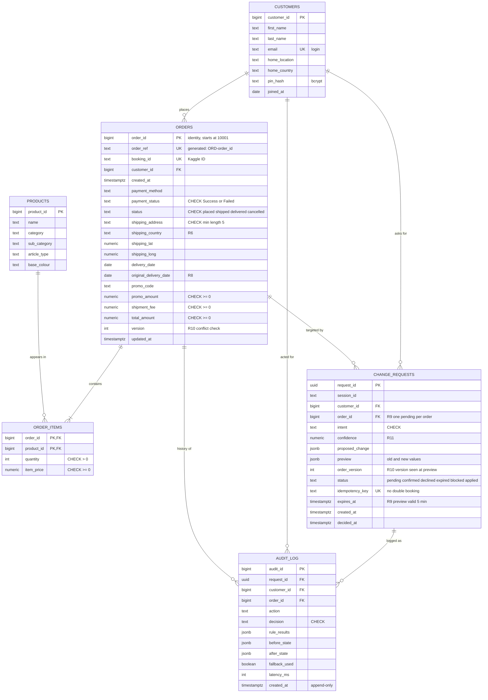

# Database Schema

PostgreSQL schema for the Autonomous Customer Support Agent. DDL: [`db/schema.sql`](../db/schema.sql). Rule IDs refer to [`BUSINESS_RULES.md`](BUSINESS_RULES.md).

## Layout

- **`raw` schema:** Kaggle CSVs loaded as-is. Never edited by the application.
- **`app` schema:** clean tables the agent reads and writes. Only `orders`, `change_requests` and `audit_log` are written at runtime.

## Entity relationship diagram

## Tables

| Table | Purpose | Written at runtime |
| --- | --- | --- |
| `customers` | Identity and login (`email` unique, PIN stored as bcrypt hash) | No |
| `products` | Product names shown in previews | No |
| `orders` | Orders the agent may change | Yes, only by the Act step |
| `order_items` | Products in each order, parsed from `product_metadata` | No |
| `change_requests` | Each preview awaiting confirmation | Yes |
| `audit_log` | Every decision, including blocked and declined requests | Yes, append-only |

LangGraph conversation checkpoints are created by `PostgresSaver.setup()` and are not part of this file.

## How the database enforces the rules

| Rule | Enforcement |
| --- | --- |
| Valid status values | `CHECK (status IN ('placed', 'shipped', 'delivered', 'cancelled'))` |
| R6 address length | `CHECK (length(trim(shipping_address)) >= 5)` |
| R9 one pending change per order | Partial unique index `uq_one_pending_change_per_order` |
| No double-booking | `UNIQUE (idempotency_key)` |
| R10 no conflicting update | `SELECT ... FOR UPDATE` and `UPDATE ... WHERE version = :seen_version` (0 rows means conflict, so roll back) |
| Tamper-proof history | Trigger blocks `UPDATE` and `DELETE` on `audit_log` |
| Valid intents and decisions | `CHECK` lists matching the API enums |

All of the above were tested on PostgreSQL 16: each invalid write is rejected.

## Dataset mapping

Column names must be confirmed against the downloaded files before loading.

| Kaggle file and column | App column |
| --- | --- |
| `customer.csv`: customer_id, first_name, last_name, email, home_location, home_country, first_join_date | `customers` (same names; `first_join_date` → `joined_at`) |
| `product.csv`: id, productDisplayName, masterCategory, subCategory, articleType, baseColour | `products` |
| `transactions.csv`: booking_id, customer_id, created_at, payment_method, payment_status, promo_code, promo_amount, shipment_fee, shipment_date_limit, shipment_location_lat, shipment_location_long, total_amount | `orders` (`shipment_date_limit` → `delivery_date` and `original_delivery_date`) |
| `transactions.csv`: product_metadata | `order_items` (parsed list of product, quantity, price) |
| `click_stream.csv` | Not loaded (out of scope) |

## Derived fields

These fields are not in the dataset. They are produced by seeded, documented code in `data/load_data.py`, never by an LLM.

| Field | Rule |
| --- | --- |
| `orders.status` | Assigned with a fixed random seed and stated proportions |
| `orders.shipping_address` | Starts from the customer's `home_location`; changed later only through the agent |
| `orders.shipping_country` | Copied from the customer's `home_country` |
| `customers.pin_hash` | One documented demo PIN, stored as a bcrypt hash |
| Dates | Shifted by one fixed offset so the latest order falls on the demo day |
| Row count | A seeded subset of customers and their orders |
